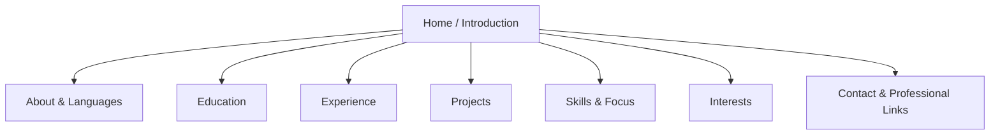
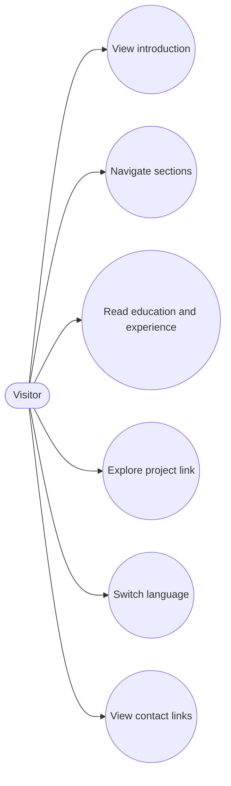
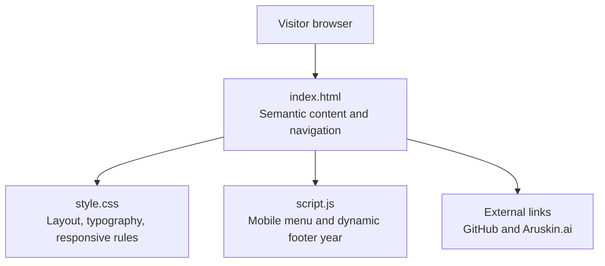

# Software design

## 1. Sitemap
The current implementation is a single-page portfolio with anchored sections.

## 2. Wireframe notes

### Desktop
- Header: wordmark at left; horizontal section navigation at right.
- Hero: introduction and calls to action on the left; abstract monogram panel on the right.
- Main content: alternating two-column sections, timeline for education, project feature panel, interest grid.
- Footer: wordmark, portfolio note and back-to-top link.

### Mobile
- Header: wordmark and collapsible menu button.
- Hero: text first, decorative monogram panel below.
- Main content: single-column sections; timeline and interest grid adapt to narrow screens.
- Navigation closes after a link is selected or Escape is pressed.

These are descriptive wireframes of the implemented layout, not screenshots or a formal visual prototype.

## 3. Use-case diagram

## 4. Component / runtime structure

## 5. Architecture
The site is a static client-side website. The browser loads one HTML document, one stylesheet and one small JavaScript file. There is no backend, database, authentication, form submission or visitor account system. The content is currently embedded in the HTML. External navigation is limited to the published GitHub and Aruskin.ai links. The mobile menu and footer year are the only JavaScript behaviors.

## 6. Design decisions and trade-offs
### DD-01 — Static website without backend
**Decision:** use semantic HTML, CSS and vanilla JavaScript with no server-side application.

**Reason:** a personal portfolio is primarily informational. Static files reduce complexity, hosting requirements, attack surface and maintenance effort.

**Trade-off:** content editing is manual; dynamic features such as a CMS or user accounts are intentionally excluded.

### DD-02 — Single-page anchored navigation
**Decision:** organize the portfolio into sections on one page.

**Reason:** visitors can scan the owner's background and navigate directly to topics without loading multiple pages.

**Trade-off:** the page can become long; clear headings, section links and responsive layout are therefore important.

### DD-03 — Minimalist visual system
**Decision:** use restrained colors, typography, whitespace and simple CSS shapes.

**Reason:** the design keeps attention on the content and avoids unnecessary assets.

**Trade-off:** the visual identity depends on typography and spacing; responsive and contrast checks remain necessary.

### DD-04 — No contact form or authentication
**Decision:** provide public professional links rather than collecting visitor data.

**Reason:** a form would introduce data-handling and validation responsibilities that are not needed for the current scope.

**Trade-off:** visitors cannot send a message directly through the site; they can use the public GitHub profile or project link.

## 7. Language and storage approach
The current code is English-only and does not yet implement a language selector. The required target is a three-language experience (Kazakh, Russian and English) with equivalent essential content and correctly declared page language. Since there is no backend or user preference storage, the intended language mechanism can be a client-side selector that swaps localized content and updates the document language; persistence across visits is optional unless later required. This design target is not yet implemented.

## 8. Reuse and licensing
The project currently uses original HTML/CSS/JavaScript and Google Fonts loaded from Google's font service. No third-party UI framework is bundled. The repository does not yet include a separate licence file; the owner should decide whether the source is intended for reuse before a licence is added. Do not imply that external font files are owned by the project.
